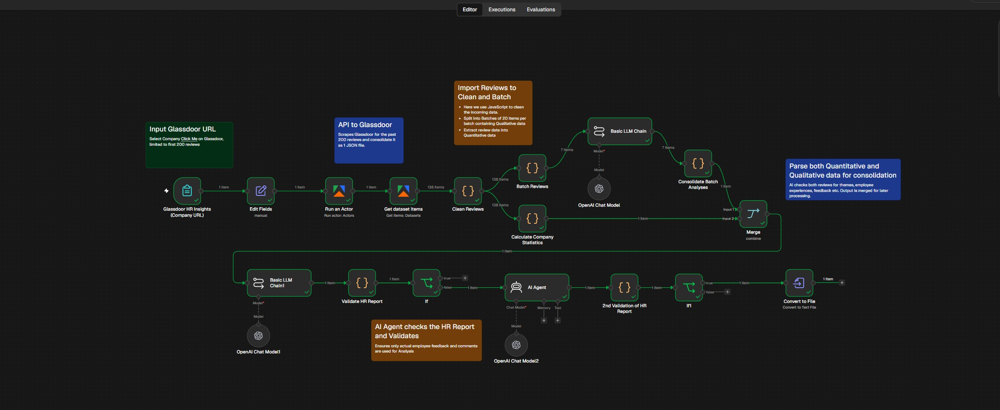

# Glassdoor HR Intelligence Insights

An automated HR analytics workflow built with **n8n, JavaScript and Large Language Models (LLMs)** to transform employee reviews into structured HR intelligence reports.

The workflow combines qualitative sentiment analysis with quantitative HR metrics, identifies recurring employee experience themes, generates actionable HR recommendations, and validates AI-generated reports before producing a downloadable Markdown report.

## Project Overview

Understanding employee sentiment from large volumes of employee reviews can be time-consuming.

This project automates much of that process by collecting Glassdoor reviews, processing the data in batches, performing AI-assisted analysis, calculating quantitative HR metrics, and consolidating the findings into a structured report.

The workflow also includes a quality-control mechanism that detects duplicate review IDs and checks report completeness before allowing the report to proceed to final output.

## Workflow Architecture

The automation follows this sequence:

1. **Data Collection** – Retrieve company reviews and associated data.
2. **Data Cleaning** – Clean and prepare review records for analysis.
3. **Batch Processing** – Split reviews into manageable batches.
4. **AI-Powered Analysis** – Analyse employee feedback and identify recurring themes.
5. **Quantitative Analysis** – Calculate average ratings, rating distributions and employee sentiment statistics.
6. **Data Consolidation** – Combine qualitative findings with quantitative metrics.
7. **HR Report Generation** – Generate a consolidated HR intelligence report.
8. **Report Validation** – Check required sections and identify duplicate supporting review IDs.
9. **AI-Assisted Correction** – Send reports containing validation errors for correction.
10. **Second Validation** – Recheck the corrected report before approving it.
11. **Report Export** – Convert the validated Markdown report into a downloadable `.md` file.



## Technology Stack

| Technology | Purpose |
|---|---|
| n8n | Workflow orchestration and automation |
| JavaScript | Data cleaning, processing and validation |
| OpenAI Chat Models | AI-powered review analysis and report generation |
| Apify / Actor integration | Review data collection and retrieval |
| Glassdoor | Employee review data source |
| Markdown | Structured HR report output |

*Provider integrations and model choices may vary depending on configuration.*

## Key Features

### 1. Batch-Based Review Analysis
Processes employee reviews in batches to make large-scale analysis more manageable.

### 2. Qualitative HR Analysis
Identifies recurring positive and negative employee experience themes, including:

- Leadership and management
- Workplace culture
- Compensation and benefits
- Work-life balance
- Career development
- Communication and transparency
- Organisational structure

### 3. Quantitative HR Analytics
Calculates and consolidates:

- Average overall company ratings
- HR dimension ratings
- Rating distributions
- Employee recommendation sentiment
- Business outlook sentiment
- Missing response counts

### 4. Automated Report Validation
Uses a custom JavaScript Code node to check:

- Required report sections
- Duplicate supporting review IDs
- Missing supporting review IDs
- Consistency of complete ID lists against stated review counts
- Representative sample limitations

### 5. AI-Assisted Error Correction
Routes reports containing validation errors to an AI Agent for correction.

The corrected report is passed through a second validation stage before approval.

### 6. Automated Report Export
Converts the validated report into a downloadable Markdown file.

## Example Workflow Output

The generated HR report contains:

1. Executive Summary
2. Positive Employee Experience Themes
3. Negative Employee Experience Themes
4. Quantitative HR Analysis
5. Key HR Concerns
6. Employee Retention and Attrition Risks
7. Isolated Issues
8. Prioritised HR Recommendations
9. Overall Company Health Assessment
10. Closing Remarks

## Example Validation Logic

The workflow uses JavaScript to identify duplicate review IDs within individual themes.

```javascript
const seen = new Set();
const duplicates = new Set();

for (const id of ids) {
  if (seen.has(id)) {
    duplicates.add(id);
  }

  seen.add(id);
}

const duplicateIds = [...duplicates];
```

The validation result determines whether the report proceeds or is routed for correction.

## Example Results

The demonstration workflow was tested using a dataset of 138 Castlery Glassdoor reviews, processed across seven AI-generated batches.

The validation process checked 11 positive and negative themes.

The second validation returned:

- Validation status: PASSED
- Themes checked: 11
- Duplicate-ID errors: 0
- Validation warnings: 11

The remaining warnings indicated that representative review IDs were supplied rather than complete supporting ID lists. These counts were therefore not independently verified.

```

## Setup and Usage

1. Install or access an n8n instance.
2. Import the workflow JSON file.
3. Configure the required API credentials and integrations.
4. Configure the LLM credentials and selected models.
5. Update the data collection parameters for the target company.
6. Execute the workflow.
7. Review the generated HR report and validation results.

Credentials should be configured within n8n and must not be committed to the repository.

## Limitations and Considerations

- AI-generated themes and recommendations require human review.
- Representative review IDs do not independently verify full theme counts.
- Duplicate-ID validation does not establish the factual accuracy of qualitative findings.
- Employee reviews may contain subjective or unverified allegations.
- Actual employee turnover cannot be inferred without internal HR data.
- Review collection and usage must comply with the relevant platform terms, privacy requirements and applicable laws.

## Future Improvements

- Export reports as PDF.
- Integrate automated report delivery through email.
- Store historical company reports for trend analysis.
- Add visual HR analytics dashboards.
- Compare employee sentiment across companies and time periods.
- Improve validation using complete source review ID lists.
- Introduce human approval before final report distribution.

---

*This project is intended as an experimental HR intelligence and analytics workflow. Examples used are for educational / experimental purposes. AI-generated findings should be treated as decision-support information this is NOT a replacement for human intuition or human judgment, when it comes to HR matters, the report is ment to aid you and not tell you what is the best strategy to solve your companie's HR problems, additional this is not definitive evidence of company-wide employee experiences.*